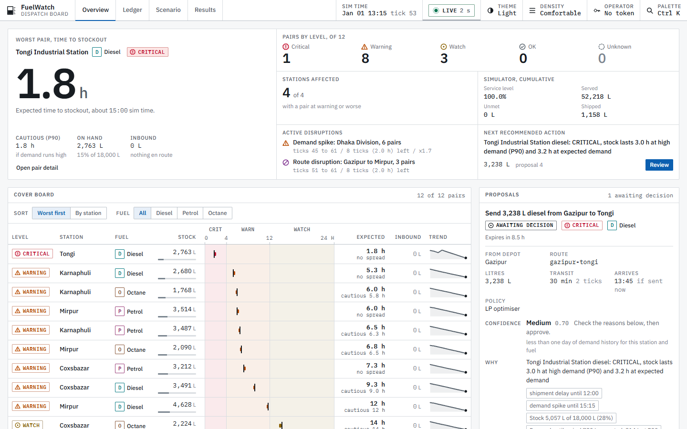

# FuelWatch: Fuel Supply Intelligence & Resilience Platform

**An operations-centre console that sees a fuel shortage coming, recommends who should ship what to whom, explains why, and keeps working when the systems underneath it fail.**

Built for the BUP CSE FEST 2026 hackathon on top of the organizer-provided BUP Fuel Supply Simulator. Python (FastAPI) backend, Next.js console, Docker Compose, Prometheus and Grafana, k6.



*The overview during the `final_combined` crisis: a demand spike in Dhaka and a closed route, with the next shipment waiting for approval.*

## Status

| Part | State |
|---|---|
| Backend: ingest, resilience, forecast, stockout estimate, allocator chain, proposals, alerts, approval, execution, ledger, audit, autopilot, metrics, logs | Built, with unit tests |
| Console: **Overview** (summary, cover board, pair detail, network, proposals, alerts) | Built |
| Console: **Ledger** (shipments in flight, every shipment line, the audit trail) | Built |
| Console: **Scenario** (run, pause, step and reset the simulator, autopilot and its limits, disruption timeline, demo script) | Built |
| Console: **Results** (replay benchmark: unmet litres and service level by policy, every measured figure, limits) | Built |
| Docker Compose stack, Grafana dashboard, k6 load test, replay benchmark, demo drill script | Built |
| Prometheus alert rules with unit tests, shown in Prometheus and Grafana (nothing sends notifications) | Built |
| CI with GitHub Actions: backend tests, console type check and build, monitoring config checks, a Compose start-up test | Added in `.github/workflows/ci.yml`; results are on the repository's Actions tab |
| Unusual demand: marked explained or unexplained, shown in the alert feed, at `/api/anomalies`, as a metric and as an alert | Built, with unit tests and an offline replay. In a live run with a demand spike, two stations were flagged as explained within a few ticks; the unexplained case has not been seen live |
| Delivery checks: a supply delivery later than any announced delay explains, and a shipment that delivered less than was sent, in the alert feed and at `/api/delivery-checks` (no metric or alert) | Built, with unit tests. A live run in which 74 shipments arrived raised no finding; neither check has been seen firing on the live simulator |
| System health board: backend, database, simulator link, forecast, decision engine, tick stream and send gate, with p95 latency, error rate, CPU and memory. At `/api/health/components`, on the **Scenario** page, with CPU and memory also in Grafana | Built, with unit tests; checked on the running stack |
| Load shedding: under too many requests at once, low-priority reads get `503` with `Retry-After`; health probes, metrics and operator actions are never refused | Built, with unit tests; one load ramp showed it does not keep latency low at this load (see Load testing) |
| User accounts | Not built |

The simulator's behaviour is documented in the [findings](docs/SIMULATOR_STATUS_FINDINGS.md). The whole system is designed in [docs/design](docs/design/README.md) (also as a [PDF](docs/design/FuelWatch-Engineering-Design.pdf)) and the console in [docs/frontend](docs/frontend/README.md). Those documents describe the design; this README says what exists.

## Quick start

You need Git and Docker with Compose v2 (Docker Desktop includes both Docker and Compose). No `.env` file, Node or Python is needed to run the platform; only the demo drill script needs Python 3.

```bash
git clone https://github.com/mmi404/fuelwatch.git
cd fuelwatch
docker compose up -d --build --wait
```

The last command returns once every service is up; then open the console. The first run needs the internet and takes several minutes, because it downloads the base images, the packages and the simulator image. Later runs reuse them. The build gets the same backend and console package versions every time ([constraints.txt](backend/constraints.txt), [package-lock.json](frontend/package-lock.json)) and downloads no fonts.

| Service | URL |
|---|---|
| Operator console | http://localhost:3000 |
| Backend API docs | http://localhost:8080/docs |
| Simulator API docs | http://localhost:8000/docs |
| Simulator admin | http://localhost:8000/admin |
| Grafana (read-only without signing in) | http://localhost:3001/d/fuelwatch-overview |
| Prometheus | http://localhost:9090 |

The simulator starts paused. Start and stop it on the console's **Scenario** page.

**To approve or reject shipments, drive the simulator or change the autopilot** the console asks for the operator token. With no `.env`, it is `demo-token`.

To change settings, copy [.env.example](.env.example) to `.env` and edit it.

| What you see | What to do |
|---|---|
| `port is already allocated` | Another program has that port. A simulator started from `simulator/docker-compose.yml` uses 8000: stop it. Or set the matching `*_PORT` line in `.env` (see the end of `.env.example`) |
| The build stops moving, or a download fails | Press Ctrl+C and run the same command again. Finished steps are cached |
| `--wait` reports an unhealthy service | `docker compose ps`, then `docker compose logs backend` (or the service it names) |
| You want a clean start | `docker compose down -v` removes the containers **and the saved data** |

### Security: what protects an approval

By default, one shared token. For named people, set up **accounts** with two roles:

| Action | `operator` | `supervisor` |
|---|---|---|
| Approve or reject a shipment | yes | yes |
| Send while the data is not live (override the safety gate) | no | yes |
| Change the autopilot | no | yes |
| Run, pause, step or reset the simulator | no | yes |

Add a line to `.env` and run `docker compose up -d --wait`. Each entry is `name:role:key`; the key is that person's password, so make a long random one (`openssl rand -hex 16`):

```bash
ACCOUNTS=rahim:operator:<random key>,nadia:supervisor:<another random key>
```

Each person types their key where the console asks for the operator token. The top bar then shows their name and role, the audit trail records them by name, and **the shared token stops working**. The server checks the role on every write. A wrong entry stops the backend from starting, and its log says which one. To revoke someone, remove the entry and run the same command.

- The default token is public (it is in this file). Set your own `OPERATOR_TOKEN` before anyone you do not trust can reach the ports; Compose publishes them on all network interfaces.
- The console does **not** ship the token to the browser. Setting `DASHBOARD_PREFILL_TOKEN` and rebuilding pre-fills it as a convenience, which puts it in the JavaScript every visitor downloads: anyone who can open the console could then approve shipments, reset the simulator or turn the autopilot on.
- Accounts are keys read from `.env`, not a sign-in service: no passwords to change in the console, no expiry, no lock-out after wrong tries, and nothing encrypts the key in transit. Put HTTPS in front before using them over a network you do not trust.

## The problem

Fuel moves through a chain: import, port, depot, route, station, customer. A delayed shipment drains a depot, a demand spike empties a station, and a closed road makes a perfectly good allocation impossible. Operators have minutes to decide and little visibility.

The simulator makes the stakes concrete (see the [findings](docs/SIMULATOR_STATUS_FINDINGS.md#3-key-behaviours)). **If nobody allocates anything, stations never refill: over two simulated days service level falls to 0.46 and about 100,000 litres of demand goes unserved.** The first tank to run dry is Tongi diesel at tick 65, about 16 simulated hours in. Intelligent allocation is not an add-on here; it is the only thing keeping the network supplied.

## What FuelWatch does

| | |
|---|---|
| **See** | One live view of 4 stations x 3 fuels, 2 depots, 6 routes, shipments in transit and active disruptions, with the age of the data always on screen. |
| **Predict** | Per station and fuel: a demand forecast with P10 / P50 / P90 values and the time to stockout, expected and cautious, counting fuel already on the road. It looks 24 simulated hours ahead. |
| **Alert** | Stockout alerts per station and fuel, grouped in the console by station with the likely cause taken from the simulator's disruption events. |
| **Decide** | An optimizer proposes shipments that respect route limits, depot stock, dispatch capacity, room in the destination tank and closed routes. |
| **Explain** | Each recommendation is a card: the action, route and arrival, confidence with its reasons, the evidence behind it, cover before and after, and the alternatives considered. |
| **Act** | A human approves an upper bound; the platform re-validates against fresh state (the quantity can only shrink), then submits with an idempotent request. An optional autopilot acts within guard limits. Everything is written to an audit log. |
| **Survive** | Cached snapshots, budgeted retries, circuit breakers, detection of simulator resets, and fallback allocators. |

One card from a live run, abridged:

```
Send 3,238 L diesel from Gazipur to Tongi                      CRITICAL · expires in 8.5 h
From Gazipur · route gazipur-tongi · transit 30 min · LP optimiser
Confidence   Medium 0.70: less than one day of demand history for this station and fuel
Why          Stock lasts 3.0 h at high demand (P90) and 3.2 h at expected demand
             shipment delay until 12:00 · demand spike until 15:15 · stock 5,057 of 18,000 L
If ignored   Cover is 3.0 h at high demand. Sending lifts it to 6.5 h and avoids
             3,238 L of unmet demand over the next 12 h
```

The card keeps the figures from the moment it was planned and says when that was and how old they are in simulated time; the cover board shows the current ones.

## Architecture

```
          BUP Fuel Supply Simulator   (REST /v1 · SSE /v1/stream · /admin)
                      │   single poller
                      ▼
 ┌──────────────────── FuelWatch backend (FastAPI) ────────────────────┐
 │ Ingest        poller + SSE watchdog + schema validation             │
 │ Snapshot      immutable WorldSnapshot, swapped atomically           │
 │ Intelligence  forecaster → stockout estimator → alerts              │
 │ Decision      LP optimizer → greedy → rules → proposals             │
 │ Execution     approve → re-validate → idempotent POST → ledger      │
 │ Ops           /livez /readyz /metrics · JSON logs · audit table     │
 └───────────┬─────────────────────────────────┬───────────────────────┘
             │ REST + SSE from cache           │ /metrics
             ▼                                 ▼
     Next.js operator console          Prometheus → Grafana
```

Four of the design rules, each earned from testing the simulator (evidence in [the findings](docs/SIMULATOR_STATUS_FINDINGS.md); the architecture, data model, flows and state machines are in [docs/design](docs/design/README.md)):

1. **Browsers never touch the simulator.** It handles roughly 60 to 76 requests per second and dropped a connection under 50 concurrent clients. The console reads our cache; only an approved action writes.
2. **REST is truth, SSE is a hint.** The stream announces ticks but stays silent when a shipment departs, arrives or fails, or when a station changes. We poll REST, so a stream failure costs only latency.
3. **A live connection is not a live stream.** A slow consumer is dropped from the broadcast while its connection stays open on keepalives, so we watch tick freshness instead.
4. **Time is read, never assumed.** Tick length comes from the simulator at runtime, and a tick that goes backwards is treated as a world reset.

## The intelligence

- **Forecast.** A structural demand model (hour-of-day level x active demand spike x a slow correction) learned online from the demand history, starting from the station profile until there is data. Its structure was checked against the simulator's own generator on 1,572 observations.
- **Stockout estimate.** A tick-by-tick projection of stock with fuel already on the road added at its expected arrival, along the mean and the P90 demand paths.
- **Optimizer.** A rolling-horizon linear program that minimises unmet litres, constrained like the simulator's own validation, committing only the first tick and re-solving on each snapshot. A greedy cover-based allocator is the fallback and a benchmark policy; simple rules sit behind it.
- **Foresight about failure.** The optimizer reads scheduled events and avoids routes about to be disrupted, because a shipment that departs onto a closed route fails and the fuel is not returned.
- **Honest uncertainty.** Every proposal carries a confidence score with reasons. The autopilot only approves above a minimum confidence; everything else waits for a person, and a card below that minimum says that human review is requested and why.

### Proof, not claims

The simulator is deterministic, so every policy is tested on identical replays: reset, inject the same crisis, step the same number of ticks, score.

Measured with `python -m fuelwatch.bench` on a second simulator (seed 12345, 192 ticks, no injected faults, one run behind each figure). Raw output, including every allocation, is in [bench/results](bench/results); the console's Results page is generated from it.

The four simulator scenarios are gentle (depots start with plenty of stock), so greedy and the LP both reach a service level of 1.000 in all four, against 0.45 to 0.46 for no action. To see the policies differ we built four harder worlds that squeeze depot supply, routes and tanks together:

| World | Do nothing | Simple rules | Greedy | LP optimizer |
|---|---|---|---|---|
| `stress_crunch` (demand x3, supply cut to 20%) | 0.243 | 0.985 | 0.989 | **0.995** (1,856 L unmet, greedy 3,982 L) |
| `stress_roads` (three routes down, demand x2.2) | 0.363 | 1.000 | 1.000 | 1.000 |
| `stress_outage_rebound` (two stations closed, then a x2.5 rebound) | 0.362 | 0.972 | 0.972 | 0.972 |
| `stress_everything` (all of the above, together) | 0.303 | 0.969 | 0.970 | **0.981** (5,374 L unmet, greedy 8,379 L) |

Service level, the simulator's own metric. No run had a rejected POST, a failed allocation or fuel lost at arrival (except 49 L for the simple rules in `stress_everything`). The LP is never worse than greedy here and better where depot supply is the limit, by about one percentage point at most; the greedy policy is already strong on this simulator. The LP takes about 0.2 s per decision at p95 against 4 ms for greedy. Full tables, limits and what was not measured are in [design 6.8](docs/design/06-algorithms.md).

## Built to fail gracefully

| Failure | What the platform does |
|---|---|
| Added latency | The console keeps being answered from the cache (about 40 ms in a drill with a 1.5 s delay) |
| Random errors | Retries each failed request up to twice with jitter, within a retry budget; never retries 404, 409 or 422. Measured: the simulator's error fault fails 24% of requests, so without retries 94% of world reads would fail |
| Simulator unavailable | Mode turns DEGRADED, then STALE; the console keeps the last snapshot, dims it and shows its age; an approval is **held** and sent once the data is fresh again. In drills: DEGRADED within a few seconds, STALE after about 14 s, LIVE 3 to 4 s after clearing outages of 16, 40 and 55 s, and the held shipment sent itself |
| Stale-data signal | Reads the simulator's stale header and turns DEGRADED |
| Stream dropped or silently stalled | Polling does not depend on it; a watchdog reconnects and reads the world again |
| Malformed fields | Rejects the payload, keeps the last good snapshot, counts the rejection and raises an alert |
| A proposal with low confidence | The autopilot leaves it for a person, and its card says that human review is requested and why |
| Simulator reset mid-run | Detects the tick going backwards, starts a new world epoch, expires old proposals |
| Optimizer fails | Falls back to greedy, then rules; the fallback is counted and recorded on the proposal |
| Traffic surge | Reads come from the in-memory snapshot; in a ramp run before load shedding existed, past about 200 requests per second the poller starved and the mode turned STALE until load dropped. The API now refuses reads when too many are in flight, optional ones first ([design 8.7](docs/design/08-resilience-and-observability.md)). In a rerun of the ramp the read breaker never opened, but latency did not improve (see Load testing) |
| World moving faster than it can be read | Above about two ticks a second a read can span two ticks. FuelWatch calls that DEGRADED and holds sends, which is why the stack runs the simulator at speed 1 |

## Observability

Prometheus metrics for simulator calls, snapshot age and tick, health mode, breaker state, retries, stream state, stockout hours, forecast error and coverage, decisions, fallbacks, proposals, allocation outcomes, open demand anomalies, rejected payloads, refused requests, API latency, and (on Linux) the backend's CPU and memory. Labels are bounded sets only. A provisioned Grafana dashboard shows them. Logs are structured JSON with request ids. `/livez` and `/readyz` are separate, because the simulator's own health endpoint stays green during injected faults. Ten alert rules in [ops/prometheus/alerts.yml](ops/prometheus/alerts.yml) cover: the backend down, a circuit breaker that has not closed, stale data, a fallback used, a stalled tick stream, forecast coverage outside 70% to 90%, ledger errors, unexplained demand, a simulator response rejected as invalid, and requests refused because of load. A lasting change that no event announces is reported for about two simulated hours; then the forecast has adapted to it and the anomaly closes. They show at http://localhost:9090/alerts and in a panel at the bottom of the Grafana dashboard. There is no Alertmanager, so **nothing sends a notification**. The rules have unit tests:

```bash
docker run --rm -v "$PWD/ops/prometheus:/rules:ro" -w /rules --entrypoint promtool prom/prometheus:v2.55.1 test rules alerts.test.yml
```

## Targets, measured

From one 90 second run on one laptop (simulator at about one tick a second, autopilot on, no faults) and the recovery drills. They are short runs, not a long soak.

| Target | Limit | Measured |
|---|---|---|
| Age of the data being served | at most 2 s | at most 1.06 s |
| `/api/snapshot`, 95th percentile, light load | under 100 ms | 33 ms over 1,324 requests |
| Requests to the simulator | at most 30 a second | 14.5 on average, 17.9 in the busiest 20 s |
| Duplicate or failed shipments | none | none among 18 shipments |
| Live again after a fault clears | within 10 s | 2.7 to 3.7 s after outages of 16, 40 and 55 s |

## Load testing

k6 open-model tests (`constant-arrival-rate`, then `ramping-arrival-rate` to find the knee), aimed at FuelWatch, never at the simulator, and repeated under an injected latency fault.

Measured on one laptop with every service on the same machine (Docker Desktop, 16 logical cores, a single backend process), so read the numbers as relative. Raw k6 summaries and the conditions are in [loadtest/results/20261126](loadtest/results/20261126).

| Scenario | Rate | p50 | p95 | p99 | Errors |
|---|---|---|---|---|---|
| Dashboard reads (status, risks, proposals, alerts) | 200 requests/s for 60 s | 14.6 ms | 170.5 ms | 292.4 ms | 0 of 12,004 |
| Plan endpoints (proposals, allocations, forecast) | 150 requests/s for 60 s | 14.0 ms | 162.4 ms | 270.5 ms | 0 of 9,000 |
| Dashboard reads, simulator 1 s latency fault active | 200 requests/s for 60 s | 13.9 ms | 75.8 ms | 155.0 ms | 0 of 12,004 |

The reads are served from the in-memory snapshot, so a slow simulator does not slow them. The ramp test shows the limit: this process keeps up to about 50 dashboard refreshes per second (200 requests per second). Beyond that, arrivals queue, latency climbs to seconds and, at the top of the ramp (up to 1,000 refreshes per second), the backend's own poller could not finish a world read inside its 5 second deadline: the mode went to STALE and the read breaker opened 5 times. It returned to LIVE about 20 seconds after the load ended (measured before the circuit breaker's retry wait was capped at 5 s). These runs were made before load shedding was added ([design 8.7](docs/design/08-resilience-and-observability.md)). The ramp was then rerun once with it ([raw summary](loadtest/results/20261126/ramp-with-load-shedding.txt)). With default limits, 39,793 of 42,792 requests (93%) were refused, and the read breaker never opened (it opened 5 times in the earlier run). The system was `LIVE` when sampled just after the run. Latency did **not** improve: p95 was 15.6 s over all requests, and 39 s over the 7% that were served, against 23.5 s when nothing was refused. During the run the liveness probe missed a 10 s limit in 6 of 30 samples, the metrics scrape got no answer in 7, and the mode read `STALE` in 4. The likely cause, not proven, is that one Python process still has to accept and read every request before it can refuse it. The two runs are not like for like: the earlier one had the autopilot on at tick 70, this one had the simulator paused at tick 130, and the backend had changed in other ways too. So shedding on its own does not make this backend survive that load. A limit in front of the process or more than one worker would be the next step. There is no per-client rate limit, and the poller still shares the event loop with the request handlers; both are known limits.

## Demo script (5 minutes)

Open the console and Grafana side by side. Each step below was run against the Compose stack. Run, pause, step and reset are on the console's **Scenario** page, which also has a short version of this script; the faults and disruptions come from `ops/demo/drill.py`, because the console cannot inject them.

**0. Start clean**

```bash
python ops/demo/drill.py reset      # clears injected faults and returns to tick 0
```

On the **Scenario** page, enter the token and press **Run**.

**1. Calm.** The network is healthy. After about 45 seconds (tick 44 or 45, mid-morning in simulated time) the first proposal appears, for Tongi diesel. Press **Pause** on the Scenario page, go to the Overview, read the card, open the pair detail chart and **approve**. The shipment appears on the network map, and the **Ledger** page shows it with its status, idempotency key and who approved it.

**2. Crisis.** Schedule the simulator's `final_combined` events from the current tick, press **Run**, wait about 10 seconds, then press **Pause**. The Scenario page's timeline shows each event as scheduled, active or ended.

```bash
python ops/demo/drill.py crisis
```

A Dhaka demand spike, a delayed depot delivery and then a closed route (Gazipur to Mirpur) appear. Levels rise, new proposals replace old ones, and none uses the closed route.

**3. Failure.** With a proposal waiting, take the simulator away.

```bash
python ops/demo/drill.py outage
```

The console turns DEGRADED, then STALE: the data dims, its age counts up, and a stale-data override appears. Approve without it: the proposal is **held**, with the reason on the card. Then recover:

```bash
python ops/demo/drill.py clear
```

The console is LIVE again within seconds and the held shipment is sent on its own.

**More failure drills.** Each simulator fault has its own command. A fault lasts 60 seconds, or the number of seconds given after its name. `python ops/demo/drill.py watch` prints the health mode, data age, breakers and retry count every second, which is a handy second window during a drill. Results of a 25 second run of each on one laptop, with the simulator running:

| Command | What FuelWatch did |
|---|---|
| `drill.py latency` (1.5 s per answer) | LIVE, then DEGRADED, then STALE as full reads stopped finishing in time (data up to 19 s old). Its own API still answered from the cache in under 50 ms |
| `drill.py errors` (about 1 request in 4 fails) | LIVE for 17 of 18 checks and DEGRADED for one; 66 retries; the breaker stayed closed |
| `drill.py stale` | DEGRADED for as long as the fault lasted |
| `drill.py stream` | No visible change: the fault refuses only new stream connections, and polling does not depend on the stream |

**A crash of FuelWatch itself.** Services restart on their own if they exit. To end the backend process:

```bash
docker compose exec backend python -c "import os, signal; os.kill(1, signal.SIGTERM)"
```

In a run on one laptop the console lost the backend after about 1 s and was LIVE again about 7 s after the crash. The shipment ledger, kept on a volume, still had every line. The autopilot comes back off.

**4. Proof.** Show the **Results** page and the Grafana dashboard: health mode, breakers, retries, simulator latency and hours to stockout.

## Reproduce the measurements

Replay benchmark, on a second simulator so the demo world is untouched. It needs Python 3.12 and the backend package:

```bash
docker compose --profile bench up -d simulator-bench      # second simulator on :8001
cd backend && pip install -e . && python -m fuelwatch.bench --sim http://localhost:8001 --scenarios stress --policies none,rules,greedy,lp --out ../bench/results
```

The Results page does not read `bench/results` while it runs. To show a new run there, regenerate its data file and rebuild the console (where a scenario and policy were run more than once, the newest run is shown):

```bash
cd frontend && npm run bench:data            # writes frontend/data/bench.json; needs Node
docker compose up -d --build frontend        # from the repository root
```

Load test, against the running stack. Keep `--no-deps`: without it Compose may recreate the backend as the test starts, and the first seconds then fail.

```bash
docker compose --profile loadtest run --rm --no-deps k6                       # dashboard reads
docker compose --profile loadtest run --rm --no-deps -e SCENARIO=knee k6      # ramp to find the limit
```

## Develop without Docker

With a simulator on `localhost:8000` (`docker compose up -d simulator`):

```bash
# backend, from backend/
pip install -e ".[dev]"
python -m pytest
OPERATOR_TOKEN=demo-token uvicorn fuelwatch.main:app --port 8080

# console, from frontend/ (forwards /api to localhost:8080)
npm ci
npm run dev
npm run typecheck
```

## Repository layout

```
backend/        FastAPI service and its tests (also the replay benchmark: python -m fuelwatch.bench)
frontend/       Next.js operator console
bench/results/  saved benchmark runs
loadtest/       k6 script and saved results
ops/            Prometheus config, Grafana provisioning and dashboard, demo drill script
docs/           simulator findings, engineering design, console research and design
simulator/      Compose file for the provided simulator on its own
```

## Documentation

| Document | What it covers |
|---|---|
| [docs/SIMULATOR_STATUS_FINDINGS.md](docs/SIMULATOR_STATUS_FINDINGS.md) | Verified behaviour of the simulator: spec conflicts resolved, the world and its demand model, allocation lifecycle and validation order, faults (with measured error rate), events, SSE limits, determinism and capacity, open questions. The design rules come from it. |
| [docs/design/README.md](docs/design/README.md) | The engineering design, in ten parts: requirements, architecture, data model (ER and class diagrams), flows (sequence and activity diagrams), state machines, algorithms, API contracts, resilience and observability, a decision log with alternatives and evidence, and risks with the build order. Also as a single [PDF](docs/design/FuelWatch-Engineering-Design.pdf). |
| [docs/frontend/README.md](docs/frontend/README.md) | The operator console: the research behind it, the design decisions, the screens and their data, and the build plan. |

## Honest limitations

- By default approval is protected by one shared token, so the audit log cannot say which person approved something. Optional accounts (see Security) add names and two roles, as keys in `.env` rather than a full sign-in system.
- The forecaster is fitted to this simulator's demand generator. That is deliberate and documented, but it will not transfer to real data without refitting.
- The simulator's `depot_constraint` event only changes a label and blocks nothing; we display and flag it but cannot make it bind.
- The benchmark uses one seed and injects no faults.
- Reinforcement learning is out of scope. If it is ever added, it has to beat the heuristic on the replay benchmark first.
- No real fuel infrastructure is read or controlled; everything runs against the simulator.

## Tech stack

Python 3.12 · FastAPI · httpx · Pydantic · SQLite · SciPy (HiGHS) · Next.js · TypeScript · CSS Modules · Docker Compose · Prometheus · Grafana · k6
