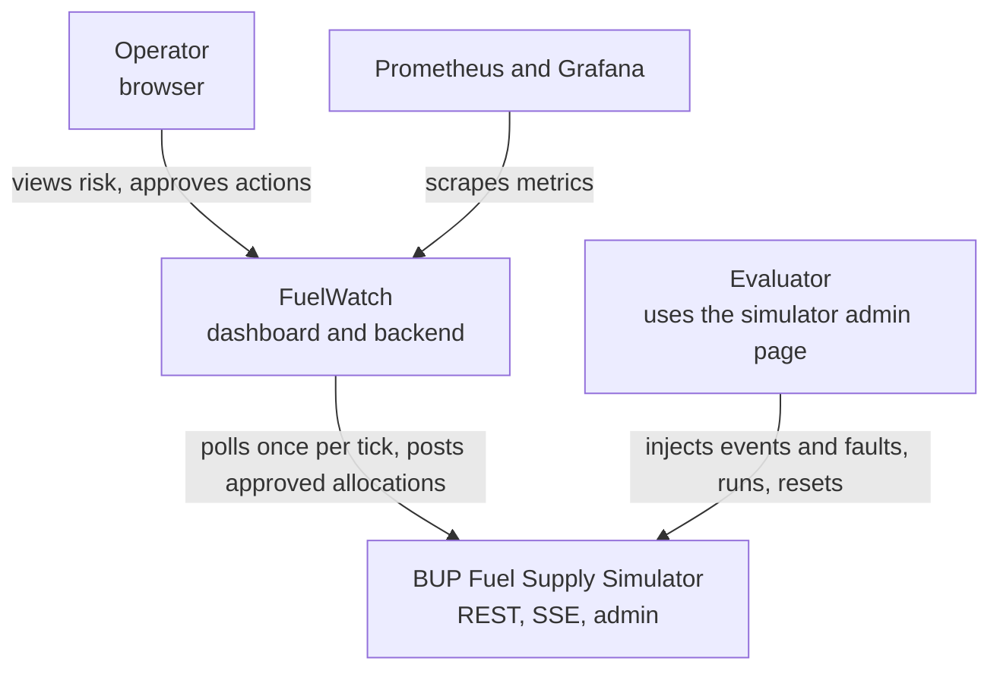
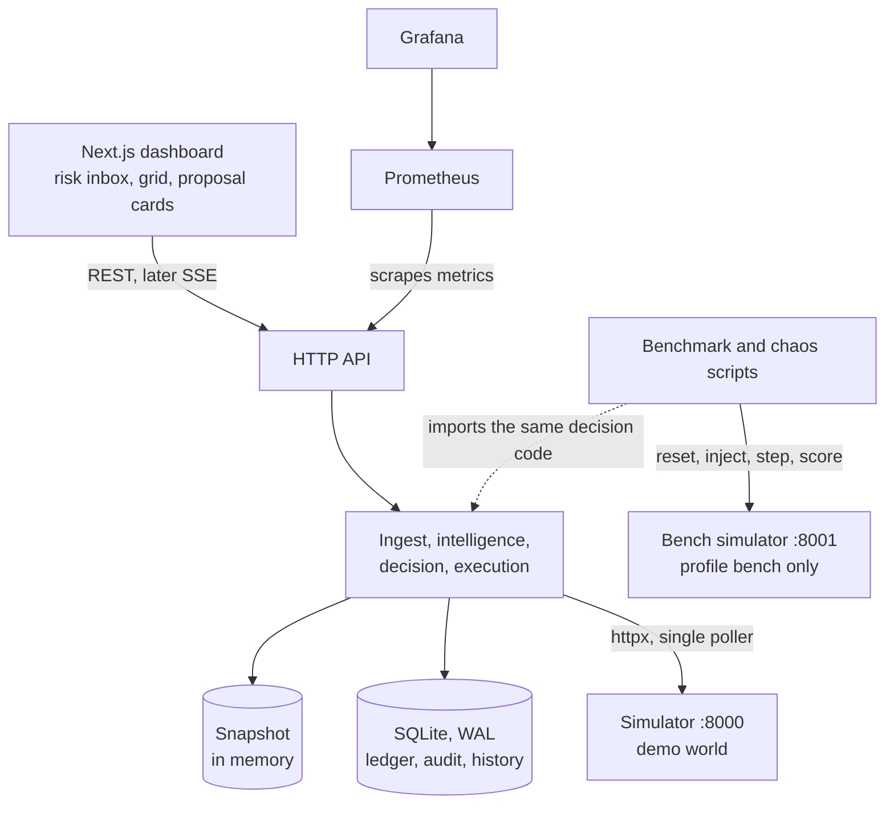
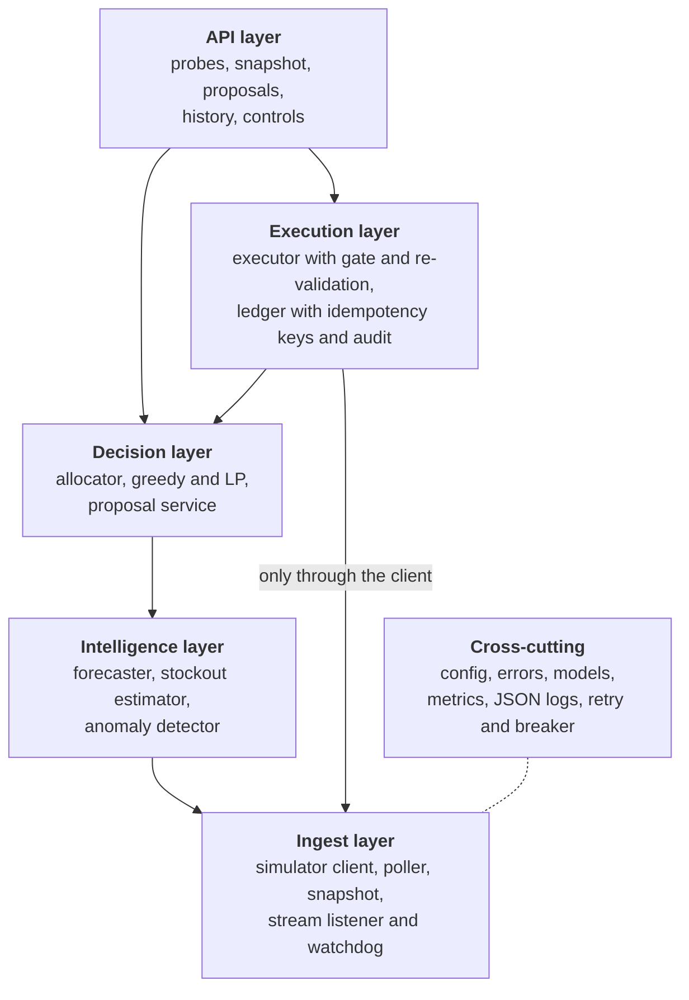
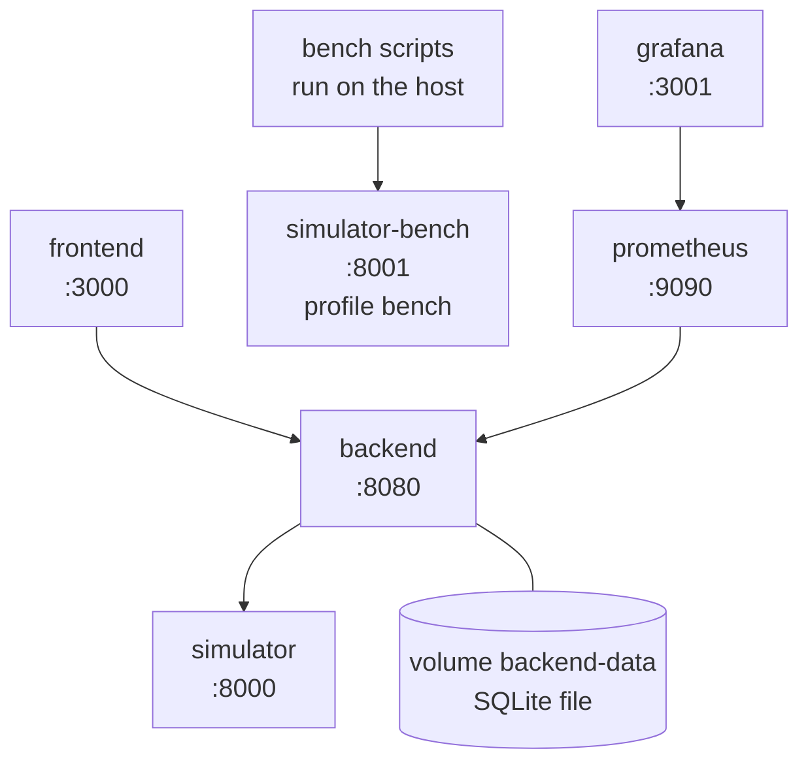

# 2. Architecture

## 2.1 System context

FuelWatch sits between the operator and the simulator. The simulator is an external system we do not control: an evaluator can inject events and faults, pause it, or reset it at any time, so the design treats it as an untrusted, unreliable dependency.

*Figure 2.1. The evaluator acts on the simulator directly, so FuelWatch must notice changes it did not cause (events, faults, resets).*

## 2.2 Containers

*Figure 2.2. The browser reaches only the backend. Benchmarks use a second simulator so the demo world is never disturbed. The "core" box is detailed in Figure 2.3.*

## 2.3 Backend components and layers

The backend is one process with strict layers. A layer may call the layers below it and never above.

*Figure 2.3. Execution is the only layer besides ingest that may call the simulator, and it does so through the same client.*

### Layering rules

1. Only `client.py` talks to the simulator. No other module imports `httpx`. This is what makes retries, breakers, metrics and error mapping apply to every call.
2. Only the poller writes the snapshot store. Everything else reads the current snapshot and never mutates it (models are frozen).
3. The intelligence layer is pure: given a snapshot and demand history it returns numbers, with no I/O. That makes it testable without a simulator and reusable by the benchmark.
4. The decision layer never sends anything. It returns proposals; only the execution layer writes to the simulator.
5. The API layer holds no business logic; it calls services and shapes responses.
6. The benchmark imports the same intelligence and decision code as the live system, so the benchmark measures what actually runs.

Rules 1 and 3 are enforced by an import test.

### Module responsibilities

Proposed layout, under `backend/fuelwatch/`:

| Module | Responsibility |
|---|---|
| `config.py` | Settings from environment variables |
| `errors.py` | Normalises both simulator error shapes; marks transient errors |
| `models.py` | Strict, frozen models for every simulator resource and the allocation request |
| `client.py` | Timeouts, error mapping, stale header, payload validation, consistent world read |
| `snapshot.py` | Immutable `WorldSnapshot`, atomic store, failure counters |
| `poller.py` | One read per tick, refresh rules, backoff, never replaces a good snapshot with a failure |
| `main.py` | App factory, probes, `/api/snapshot` |
| `resilience.py` | Retry budget, circuit breakers |
| `history.py` | Demand history sync into SQLite, per world epoch |
| `forecast.py` | Structural forecaster, bands, adaptive multiplier |
| `stockout.py` | Projection and risk levels |
| `anomaly.py` | Explained and unexplained surges |
| `allocator.py` | Rules, greedy allocator, LP allocator |
| `proposals.py` | Proposal build, explanation, expiry, supersede |
| `executor.py` | Execution gate, re-validation, idempotent POST, outcome tracking |
| `ledger.py` | SQLite access for proposals, executions, audit |
| `stream.py` | SSE listener with a tick-staleness watchdog |
| `metrics.py` | Prometheus metrics |

Outside the backend, `bench/` holds the replay benchmark and the chaos scripts.

## 2.4 Technology choices

Each choice is argued in the decision log (part 9); this table is the summary.

| Concern | Choice | Decision |
|---|---|---|
| Backend | Python 3.12, FastAPI, httpx, Pydantic v2 | ADR-01 |
| State | In-memory snapshot plus SQLite in WAL mode | ADR-03 |
| Forecasting | Structural model with online learning | ADR-05 |
| Allocation | Greedy first, rolling-horizon LP (SciPy HiGHS) second | ADR-06 |
| Operator workflow | Propose, approve, execute; optional autopilot | ADR-07 |
| Frontend | Next.js with TypeScript, polling first | ADR-10 |
| Metrics | Prometheus client, Grafana dashboards | ADR-11 |
| Packaging | Docker Compose, one command | ADR-12 |

## 2.5 Deployment

One Compose file runs everything. Ports are configurable through `.env`; the values below are the defaults.

*Figure 2.4. All services share one Compose network.*

Deployment rules:

- The simulator container is pinned to the published image and to `SIMULATION_SPEED=8`, `TICK_MINUTES=15`, `SIMULATOR_START_MODE=paused`, but the backend never depends on those values.
- Every service has a health check; the backend's `/readyz` gates the frontend.
- The SQLite file lives on a named volume. Deleting it loses only reconstructable data and the audit trail (part 3.4).
- No canary or blue-green. Rollback is redeploying the previous tag.
