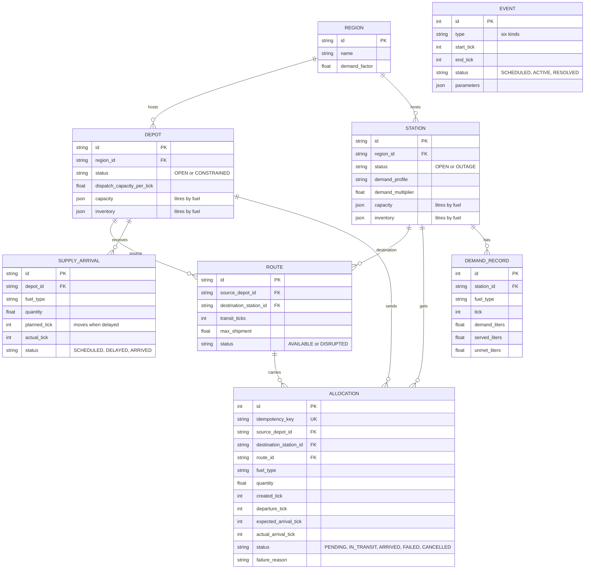
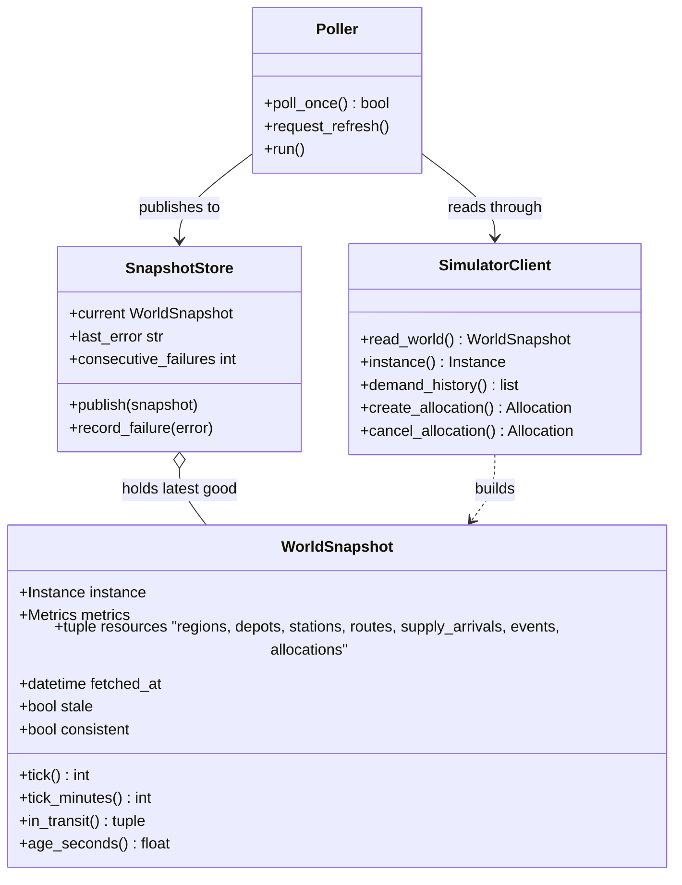
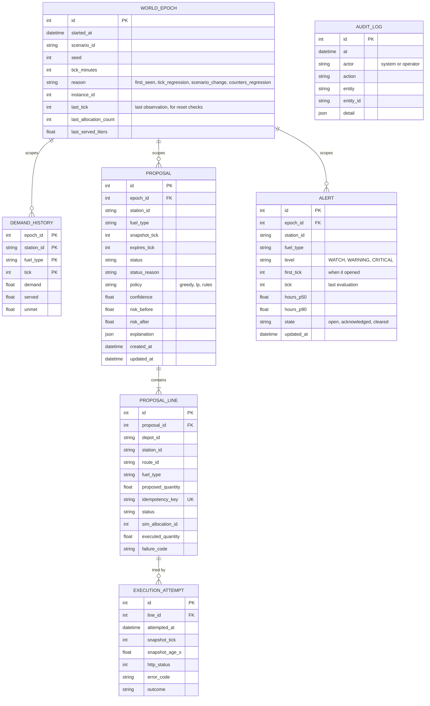

# 3. Data model

Three models exist and they must not be confused: the **simulator's domain model** (what it exposes, which we do not control), the **in-memory snapshot** (our immutable copy of one moment), and **our persistence schema** (what we must keep durably).

## 3.1 The simulator's domain model

Shapes are taken from the live API (`[live]`) and the simulator's source (`[code]`). Inventory and capacity are maps from fuel type to litres, shown here as JSON attributes.

*Figure 3.1. `EVENT` has no drawn relationships because it refers to routes, stations and depots only through ids inside its `parameters` JSON, by convention and not by key. There is also one `INSTANCE` row (tick, `sim_time`, `tick_minutes`, status, seed, scenario) and a `METRICS` summary (served, unmet, service level, allocation litres, failures).*

Facts that shape the design:

- **Fuel reaches a station only through an allocation.** There is no supply arrival to a station.
- **A depot's stock changes in three ways:** debited when we POST, refunded if we cancel a `PENDING` allocation, credited by a scheduled `SUPPLY_ARRIVAL` (possibly delayed).
- **`expected_arrival_tick` is `created_tick + transit_ticks`.** The simulator processes a tick in this order: events start, supply, departures, arrivals, demand, events end (`[code]`). A POST made when the instance is at tick `c` departs in the processing of tick `c`, and its fuel is added in the processing of tick `c + transit_ticks`, before that tick's demand. It only becomes visible as `ARRIVED` once the instance tick has moved past that, which is `transit_ticks + 1` steps after the POST (`[live]`).
- **The instance `tick` is the next tick to be processed.** A snapshot at tick `T` contains demand history for ticks `0` to `T - 1`.
- **Demand history has 12 rows per tick** (4 stations by 3 fuels) and is the only record of demand, served and unmet litres.

## 3.2 The in-memory snapshot

One `WorldSnapshot` is built per refresh and swapped into the store as a single reference assignment, so a reader sees either the old world or the new one, never a mixture.

*Figure 3.2. `stale` is true when the simulator sent `X-Simulator-Stale: true` on any read. `consistent` is false when the tick moved while the world was being read and the retries ran out.*

Derived values are computed on demand, never stored: `in_transit` is the allocations in `PENDING` or `IN_TRANSIT`; forecasts, stockout estimates and proposals are functions of a snapshot plus demand history.

## 3.3 Persistence schema

SQLite in WAL mode. Everything is keyed by a **world epoch**: a counter that increments when the simulator is reset or replaced, so tick numbers from different worlds never mix.

*Figure 3.3. `AUDIT_LOG` refers to other rows by `entity` and `entity_id` strings so it survives any table being rebuilt.*

Design notes:

- **`idempotency_key` is unique and written with the line, before any request is sent.** Its format is `fw-p{proposal_id}-l{line_id}`. If a POST times out, the retry sends the same key and body, and the simulator returns the existing allocation (`[live]`), so a retry cannot create a second shipment.
- **Demand history is synced by gap, not by schedule.** The endpoint is newest-first, has no `since` filter and returns at most 2,000 rows per response (`[live]`). After each snapshot the tracker finds the newest run of complete ticks in the database (a tick is complete when it holds all 12 rows), asks for the missing ticks plus one of slack, and reads station by station when that would exceed the cap. A gap that survives widens the next request, so a restart or a failed sync heals itself. The forecaster needs a contiguous recent window, so older rows behind a gap are kept but not counted.
- **A proposal is for one station and one fuel**, so supersession and the explanation card have one subject; its lines are the shipments for that pair (several depots or routes in the same tick, sharing each depot's dispatch capacity). The key is assigned in the same transaction that stores the line, so no line exists without one.
- **`proposed_quantity` is an upper bound.** `executed_quantity` is what was actually sent after re-validation and is never larger.
- **`execution_attempt` is append-only.** Every try, success or not, is a row, so the audit trail shows exactly what happened under retries.

## 3.4 What can be lost

| Data | Class | If the SQLite file is lost |
|---|---|---|
| Snapshot, forecasts, breaker state | Ephemeral | Rebuilt on the next poll |
| `DEMAND_HISTORY` | Reconstructable | Refilled from `GET /v1/demand-history` (about 2,300 rows for 192 ticks; one response is capped at 2,000 rows, so a longer window is read station by station) |
| `ALERT` | Reconstructable | Regenerated by the next evaluation |
| `PROPOSAL`, `PROPOSAL_LINE`, `EXECUTION_ATTEMPT`, `AUDIT_LOG` | Durable | **Not recoverable.** The simulator's own allocation list still shows what was sent, but not who approved it or why |

Because only the durable class matters, backup and migration effort goes there. After a crash between "key stored" and "POST sent", recovery re-sends the same request; the idempotency key makes that safe.

## 3.5 Units and conventions

- **Time:** ticks internally. `hours = ticks x tick_minutes / 60`, computed at the edge from the snapshot's own `tick_minutes`.
- **Volume:** litres as floats. Quantities are rounded to whole litres when posted.
- **Identifiers:** the simulator's string ids are used as-is; our own ids are integers.
- **Enumerations:** fuel types, statuses and event types are strict enums; an unknown value fails validation and the previous snapshot stays in service.
