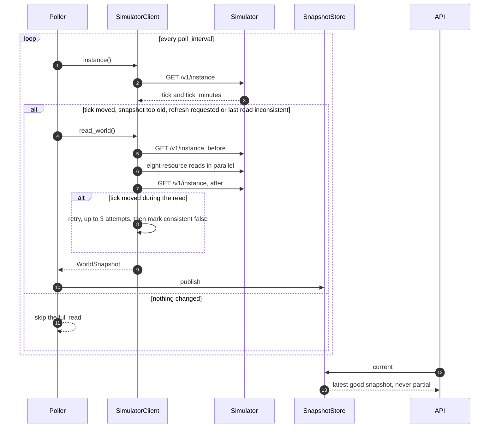
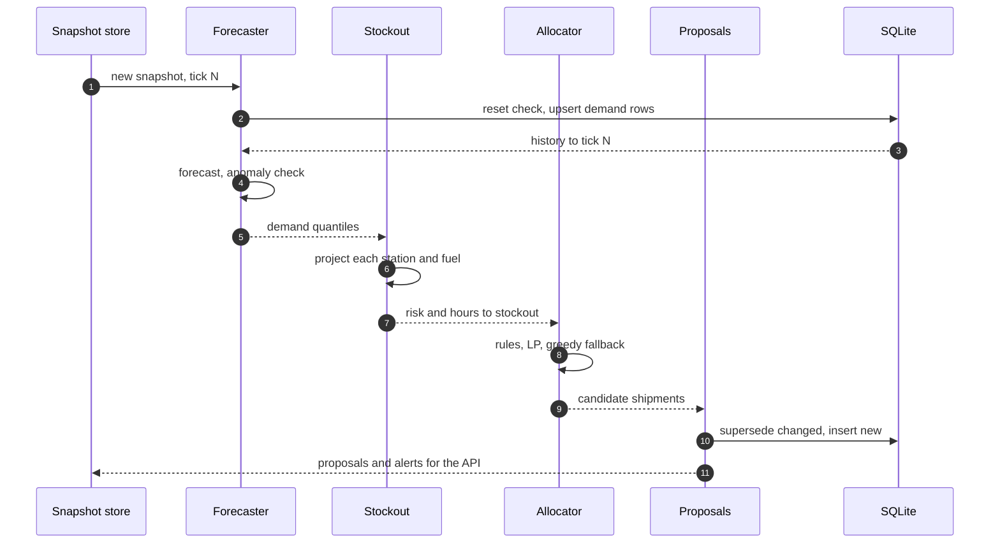
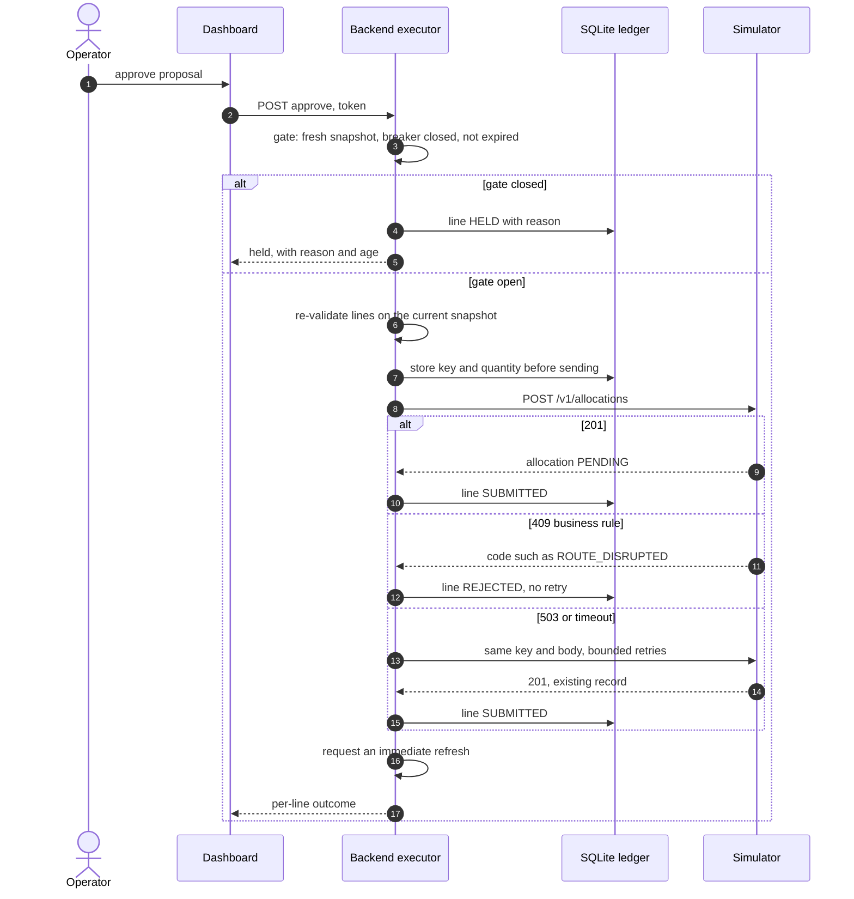
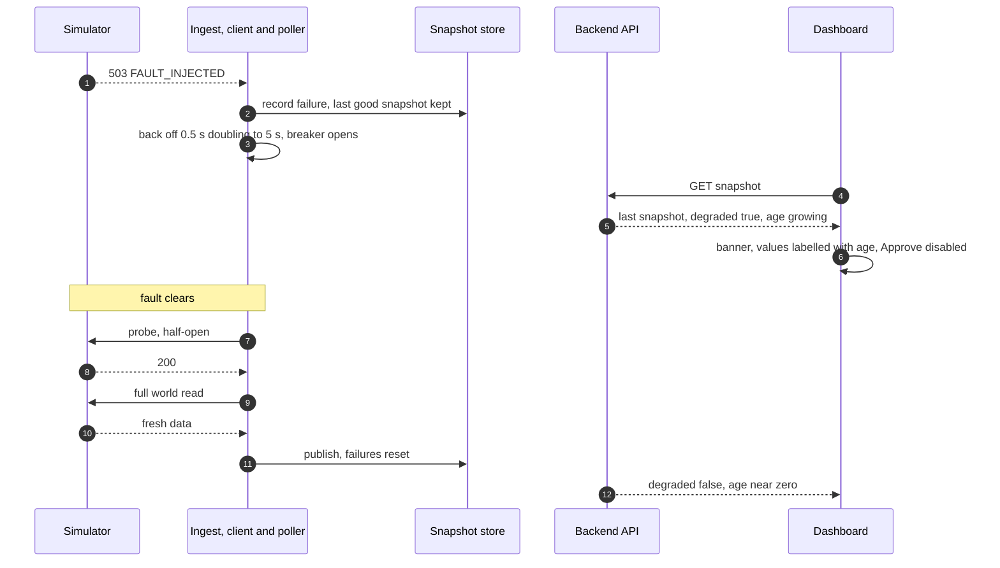
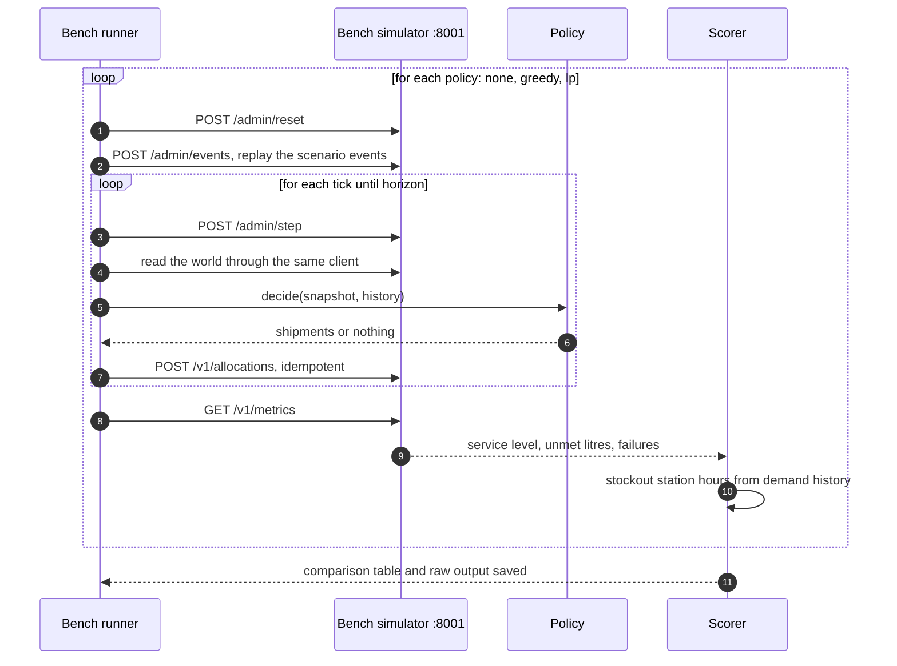
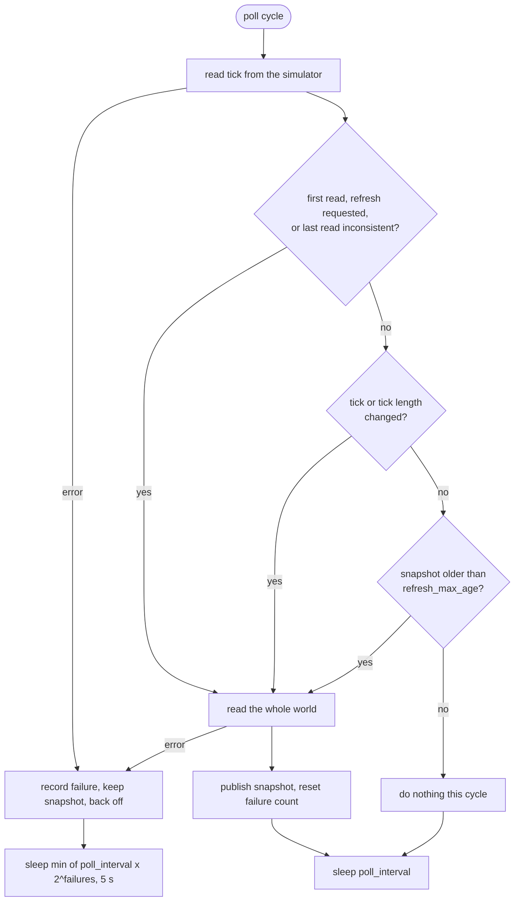
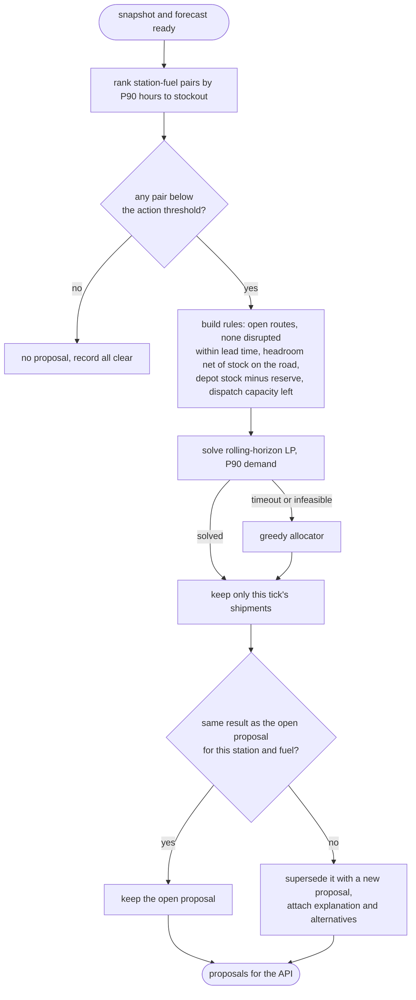
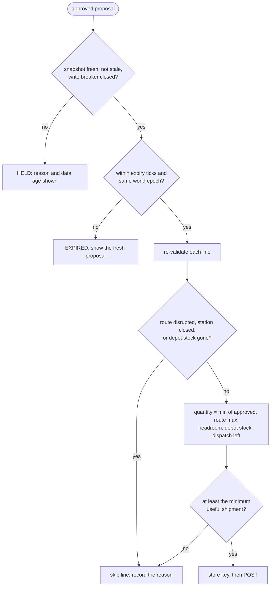
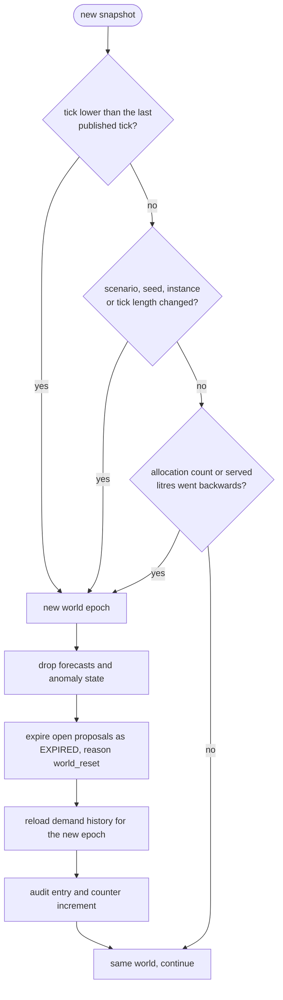

# 4. Flows

Sequence diagrams show who talks to whom and in what order; activity diagrams (drawn as flowcharts) show the decision logic inside one component.

## 4.1 Ingest cycle

The poller asks for the tick every `poll_interval` (0.5 s by default). It reads the whole world only when something warrants it. The tick is read before and after the world, because a read that straddles a tick boundary would mix two moments (a torn read).

*Figure 4.1. A failed `instance()` or `read_world()` never reaches `publish`; the failure is recorded and the previous snapshot stays current.*

Load budget: a refresh is 10 requests (2 instance reads plus 8 resources), plus 1 instance request per cycle. At the default cadence the worst case is two refreshes per second, about 22 requests per second, which is the 30 requests per second budget (NFR-3) with a margin. The measured tick rate is about 4.6 per second, so the refresh rate is capped by the cadence, not by the tick rate. This is a calculation, to be confirmed by the request counter during the benchmark.

## 4.2 Recommendation cycle

Runs once per published snapshot, in the background, never in a request path.

*Figure 4.2. Anything in this chain can fail; each step has a defined fallback (part 8.4), and a failure leaves the previous proposals in place, marked with their snapshot tick.*

## 4.3 Approve and execute

Approval is an upper bound. The operator approved a proposal made at tick N; execution happens at tick M, usually larger.

*Figure 4.3. A validation 409 does not consume the idempotency key, and the same key with the same body returns the existing allocation. Both facts are `[live]`, and both are why a retry is safe.*

Approval starts with a fresh read of the world, so the gate and the re-validation see the simulator as it is now, not as it was when the proposal was made. Lines are sent one after another and each one counts what the earlier ones used (depot stock, dispatch capacity, room at the station), because the snapshot cannot show them yet.

If all retries end with an unknown outcome, the line becomes `UNKNOWN` and every later snapshot is searched for an allocation carrying its key; a match resolves it to `SUBMITTED`. A snapshot read at least 10 seconds after the last attempt that still has no such allocation resolves it to `FAILED`, because by then the request cannot still be in flight. The system never guesses.

After submission the line is tracked from snapshots: `PENDING`, `IN_TRANSIT`, then `ARRIVED`, `FAILED` or `CANCELLED`, with `executed_quantity` compared to what the station actually received.

## 4.4 Failure and recovery

Shown for the hardest case: the simulator becomes unavailable (all `/v1/*` return 503, including POST), then recovers.

*Figure 4.4. The last good snapshot keeps being served throughout, `degraded` and the failure count appear within seconds, and the feed catches up after the fault clears. The write path stays blocked until the breaker closes.*

## 4.5 Replay benchmark

The benchmark proves the intelligence. The simulator is deterministic (two runs gave identical state hashes), so every policy faces the same world.

*Figure 4.5. The policy code is exactly the code the live system runs, imported, not re-implemented. Results are saved with their raw output so the README table can cite a file.*

## 4.6 Poller refresh decision

*Figure 4.6. Backoff is exponential and capped at 5 seconds so recovery is detected quickly even after a long outage.*

## 4.7 Allocation decision

*Figure 4.7. Only the first tick of the plan is committed, then the whole problem is solved again at the next snapshot (rolling horizon). That makes the plan self-correcting when events change the world.*

## 4.8 Execution gate

*Figure 4.8. Quantity can only shrink at execution. Approving 5,000 L never results in 5,001.*

## 4.9 World reset detection

An evaluator can press Reset on the simulator at any moment. The tick then goes backwards, and everything we cached about the old world is wrong.

*Figure 4.9. Without this, a reset during a demo would leave stale proposals on screen and a forecaster trained on the wrong world.*

A reset leaves the instance id, scenario and seed unchanged and restarts the history row ids (`[live]`), so only the tick and the running counters can reveal it. The check runs before the snapshot is published, so nobody sees the new world under the old epoch. One case is invisible: a reset followed by a run past the old tick within one poll interval, with nothing allocated. Demand is seeded, so the stored history is still correct for the new world, and the loss is limited to state we created ourselves; once the executor exists, an allocation of ours that is missing from the list is a further signal.
