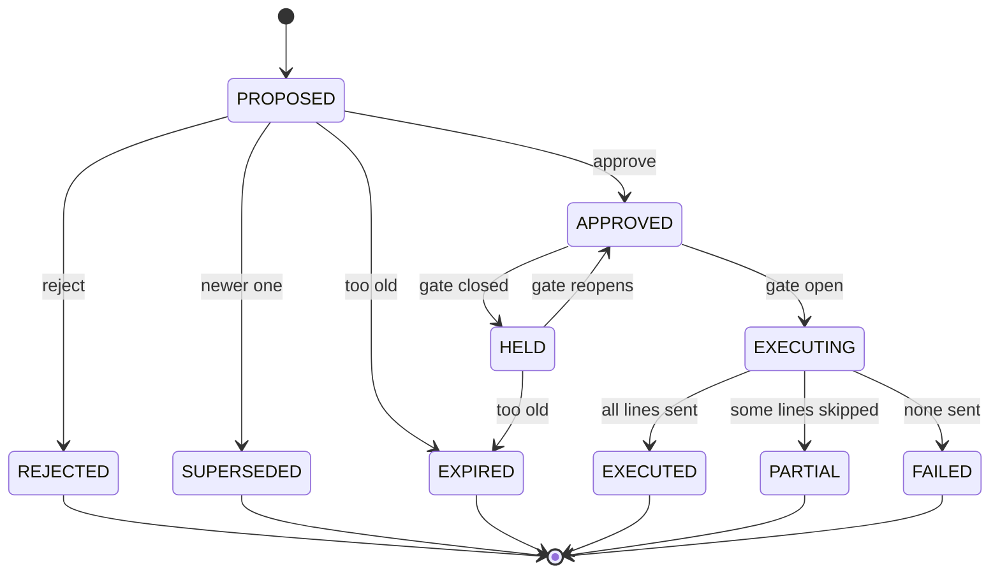
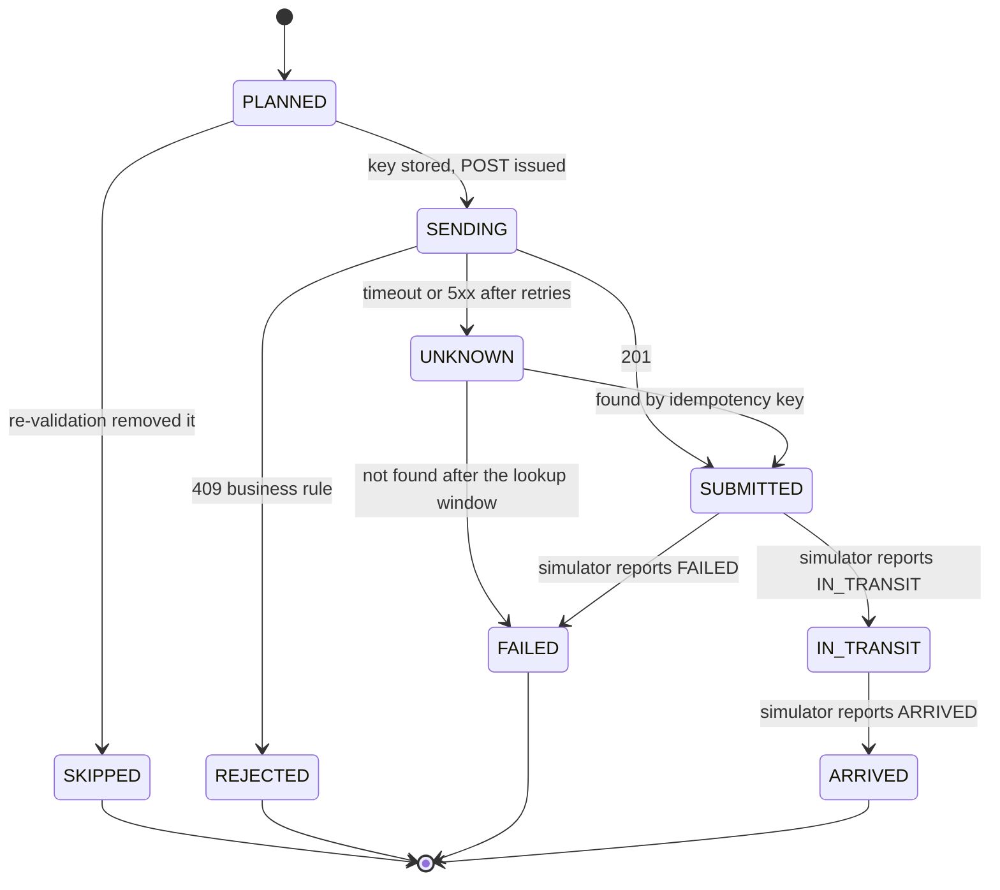
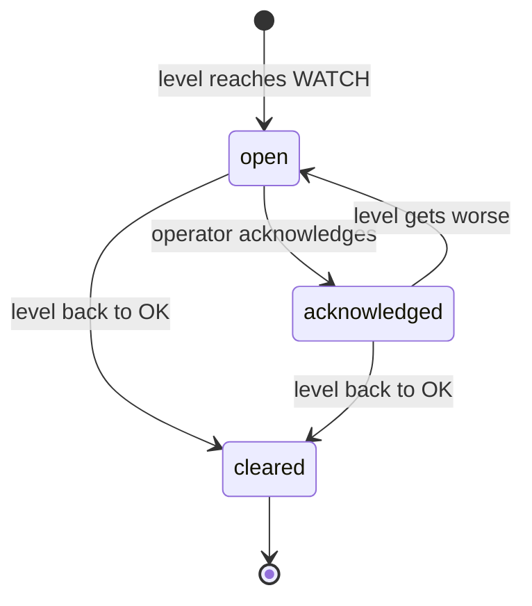
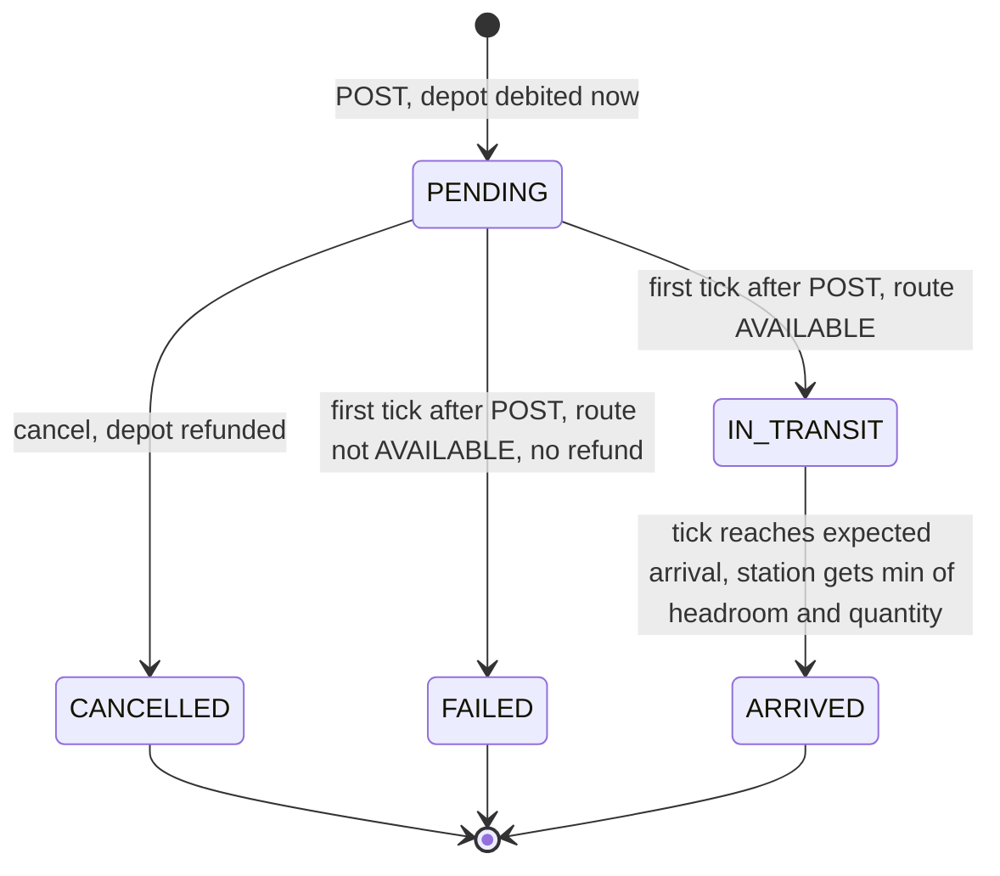
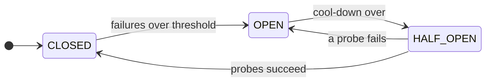
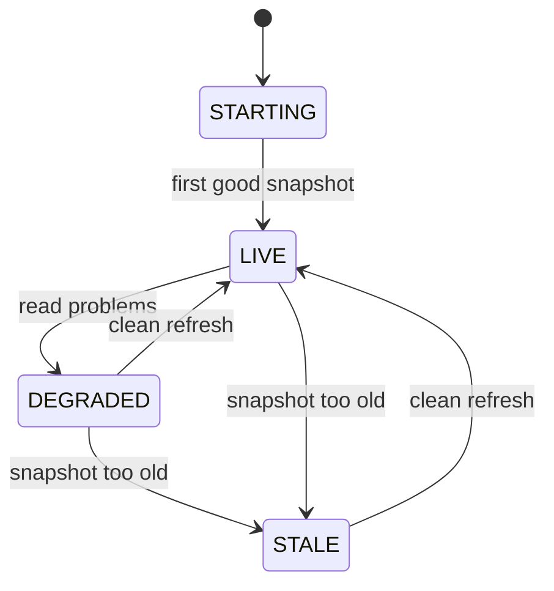
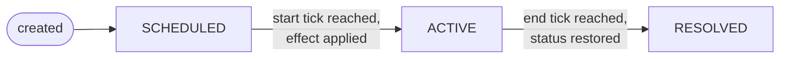
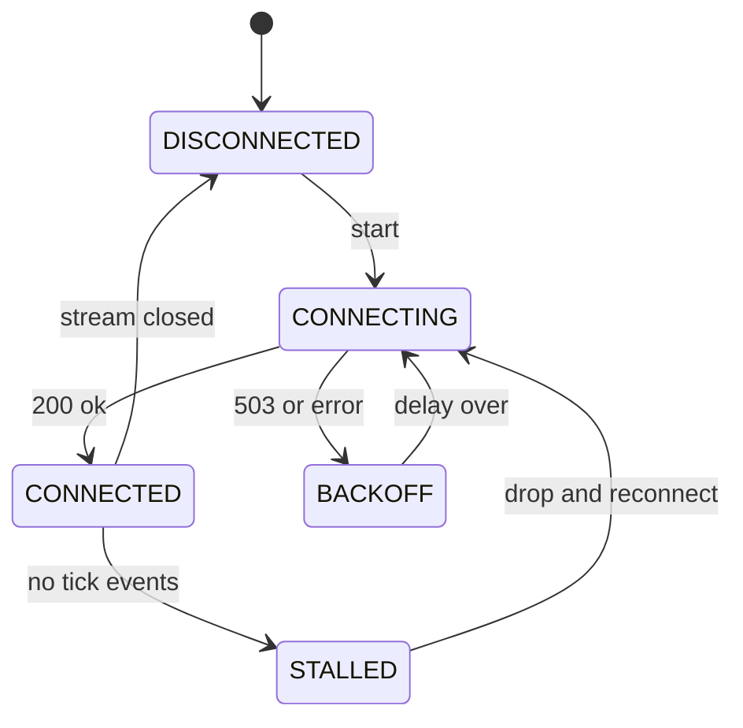

# 5. State machines

Five things in the system have a lifecycle that matters: our proposals, the simulator's allocations, our circuit breakers, the system's own health mode, and the stream connection. Making each explicit removes the "what happens if" questions from the code.

## 5.1 Proposal lifecycle

A proposal is a recommendation made at a snapshot tick. It lives until it is acted on, replaced or too old to trust.

*Figure 5.1. Only `PROPOSED` and `HELD` can expire. Once `EXECUTING` begins, the proposal always ends in `EXECUTED`, `PARTIAL` or `FAILED`.*

| Transition | Trigger |
|---|---|
| `PROPOSED` to `SUPERSEDED` | A newer snapshot produces a materially different proposal for the same station and fuel, or no proposal at all for it because the shipment is no longer needed |
| `PROPOSED` or `HELD` to `EXPIRED` | The expiry tick passes, or the world epoch changes (a reset) |
| `APPROVED` to `HELD` | The execution gate is closed: data too old, stale flag, or write breaker open |
| `HELD` to `APPROVED` | A later snapshot finds the gate open again; the held approval stands (within its expiry) and runs without the operator doing anything |
| `EXECUTING` to `PARTIAL` | Re-validation skipped some lines, or the simulator rejected some with a 409 |

A proposal is for one station and one fuel; its lines are the shipments for that pair. After every snapshot the allocator's plan is compared with the open proposal for each pair:

| Plan for the pair | What happens |
|---|---|
| Same depots and routes, and the total within the larger of 500 L or 15% of the old total | The open proposal is kept. Its numbers stay those of its own snapshot tick; re-validation at execution time uses the live world |
| Anything else | A new proposal is created and the old one becomes `SUPERSEDED`, naming its replacement |
| No shipment | The open proposal becomes `SUPERSEDED` with the reason "no longer recommended" |

A stale snapshot, or one read while the tick moved, creates no new proposals; the open ones wait. The 500 L and 15% are initial values: tight enough that a proposal follows the plan, loose enough that a rising need does not replace it every tick.

Expiry is measured in ticks, not seconds, so it means the same thing at any simulation speed. The initial value is 40 ticks (10 simulated hours), to be tuned from the benchmark; it is deliberately long because re-validation, not expiry, protects correctness (ADR-07).

### Execution rules

| Rule | Behaviour |
|---|---|
| Gate | Closed when there is no snapshot, the snapshot is `STALE`, or the write breaker is open. `DEGRADED` closes it unless the request carries `override_stale`; the override is audited and never opens a breaker or a stale snapshot |
| Fresh read | Every approval, and every automatic resume, starts with a full refresh |
| Quantity | The minimum of the approved litres, route maximum, depot stock, dispatch capacity left (this tick, including what earlier lines of the run used) and headroom at the destination; whole litres; never more than approved |
| Smallest shipment | The smaller of 1,000 L and half the approved litres. A line below it is skipped with the limit that caused it as the reason |
| Skipped | Route disrupted at the current tick, station in outage, unknown route or depot, or a limit above. The reason is the line's `failure_code` and an audit row |
| Written first | The line's quantity and an attempt row `SENDING` are stored before the request, so a crash always finds a key, a quantity and a time to resolve from |
| Breaker opens mid-run | The line goes back to `PLANNED`, nothing was sent, and the proposal is held |
| Closed without approval | A proposal that is superseded, expired or rejected marks its `PLANNED` lines `SKIPPED` |
| World reset | Old lines still `PLANNED` become `SKIPPED`; lines already sent, sending or unknown become `FAILED` with `WORLD_RESET`; `APPROVED` and `HELD` proposals expire; an `EXECUTING` one is closed from its lines |

### Line states

One proposal has one or more lines, and each line is a single allocation request.

*Figure 5.2. After `ARRIVED`, the litres the station actually received are compared with `executed_quantity`. A shortfall means fuel was lost to headroom and is counted.*

### Alert lifecycle

An alert tracks one station and fuel while its stockout level is `WATCH` or worse. It is separate from proposals, since an alert can exist where no shipment is possible.

*Figure 5.2b. The level of an open alert is refreshed on every snapshot, so one alert follows a station through WATCH, WARNING and CRITICAL instead of opening three. An unknown assessment (no forecast yet) leaves an alert as it is. A world reset clears all alerts of the old epoch.*

## 5.2 The simulator's allocation lifecycle (observed)

This is not ours, but we must model it exactly because its quirks cost fuel.

*Figure 5.3. `[live]` for each transition. The route is checked at departure only (`[code]`), so a disruption after departure does not fail an allocation already on the road. The two costly cases are the unrefunded `FAILED` and the silent loss at `ARRIVED`.*

## 5.3 Circuit breaker

One breaker per call class (reads, writes, stream connect) so a failing class does not block the others. A write breaker that opens does not stop reads.

*Figure 5.4. Only transient errors count as failures; a 409 means the simulator is healthy and said no. A request counts once, by its final outcome after its retries.*

| Transition | Initial threshold (tuned by the chaos drills) |
|---|---|
| `CLOSED` to `OPEN` | 5 consecutive failed requests, or a failure rate of 50% or more over at least 10 requests in 30 s |
| `OPEN` to `HALF_OPEN` | Cool-down of 5 s |
| `HALF_OPEN` to `CLOSED` | 2 consecutive probes succeed |
| `HALF_OPEN` to `OPEN` | Any probe fails; the cool-down doubles up to 30 s |

Two rules keep the breaker honest. It counts requests after their retries, not attempts: retries already absorb a single failed attempt, and counting attempts opened the breaker during a live run at the simulator's default 24% error rate (`[live]`, 80 of 100 refreshes refused), which is exactly the fault the system must ride through. A probe is sent once and not retried, because its job is to find out whether the simulator is back, and a request cancelled before it finishes (for example by the world deadline) counts as a failure so it cannot leave a probe stuck.

## 5.4 System health mode

The operator needs one word that says how far to trust the screen. It is derived from the snapshot and the failure counters, never set by hand.

| Mode | Meaning | Dashboard | Execution | `/readyz` |
|---|---|---|---|---|
| `STARTING` | No snapshot yet | Loading state | Blocked | 503 |
| `LIVE` | Fresh and consistent | Normal | Allowed | 200 |
| `DEGRADED` | Serving the last good snapshot while reads fail, or the data is flagged stale | Banner with age; values labelled | Blocked unless the operator overrides, and the override is audited | 200 |
| `STALE` | Snapshot older than the limit (15 s initially) | Banner; values greyed with age | Blocked | 503 |

*Figure 5.5. The mode is derived from the snapshot and the failure counters, never set by hand. `/readyz` returns 503 when the snapshot is older than the limit (15 s initially).*

## 5.5 Event lifecycle in the simulator (observed)

Events are how the evaluator disturbs the world. An event is created with a start tick and a duration; when the start tick is reached its effect is applied, and when the end tick is reached the entity status is restored. Our app reads them to explain changes and to avoid routes about to close.

| Event type | Effect while `ACTIVE` | What we do |
|---|---|---|
| `demand_spike` | Multiplies each named station's `demand_multiplier` (all stations if none are named) when it starts, and divides it back when it ends; spikes stack | Read `demand_multiplier` from the snapshot, so the forecast follows a spike the moment it starts; label the change explained |
| `route_disruption` | Route becomes `DISRUPTED`; a POST on it returns `ROUTE_DISRUPTED`; an allocation still `PENDING` at the next tick fails | Exclude the route, from before it starts |
| `station_outage` | Station becomes `OUTAGE`; served demand is zero; POST returns `STATION_CLOSED` | Exclude the station; flag it as a service failure, not a stock shortage |
| `depot_constraint` | Depot label becomes `CONSTRAINED`; nothing is actually blocked | Display and flag only |
| `shipment_delay` | At its start, moves the planned tick of matching `SCHEDULED` arrivals later by `delay_ticks`; they show `DELAYED`. **Permanent: not undone when the event ends.** | Use the planned tick in the snapshot; never assume the original |
| `supply_shortfall` | At its start, multiplies the quantity of matching undelivered arrivals by `factor`. **Permanent.** | Use the quantity in the snapshot |

Two consequences. First, `shipment_delay` and `supply_shortfall` only touch arrivals that exist and are undelivered when the event starts, so their effect is visible in `GET /v1/supply-arrivals` and there is nothing to model beyond reading it. Second, a depot refuses supply it has no room for (`added = min(room, quantity)`, `[code]`), so a full depot loses fuel when a delivery lands. Shipping out of a depot just before a large delivery is therefore worth something, and the LP's depot balance includes depot capacity for that reason (part 6.4).

## 5.6 Stream listener

The stream is an optional accelerator, so its states never affect correctness. They matter for the operator's trust and for the metrics.

*Figure 5.6. `STALLED` means the REST tick advanced but no tick event arrived, or no bytes arrived for 30 s. It exists because the simulator drops a slow client from its broadcast list while keeping the HTTP connection open on keepalives. A connection that looks alive can be deaf, so liveness is judged by tick progress, never by connection state. On every reconnect the poller does a full REST refresh, because the stream replays nothing.*
