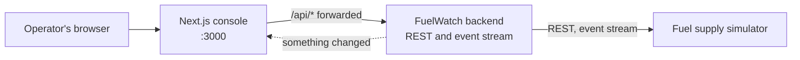

# Operator console: design and implementation plan

What the console shows, where each value comes from, how it behaves, and the order in which it is built. Reasons are in [design decisions](02-design-decisions.md). This document describes the design; the project README states how much of it exists.

## Purpose

An operator should be able to answer, in this order:

1. Can I trust what I see?
2. Which station and fuel runs out next, and when?
3. What does FuelWatch recommend, why, and what happens if I do nothing?
4. What did we send, and what happened to it?

The network is small (4 stations, 2 depots, 6 routes, 3 fuels, so 12 station-fuel pairs). The console shows all of it.

## Architecture

- The browser talks to one origin. The console forwards `/api/*` to the backend, so no cross-origin setup is needed. Compression is off so that the event stream is not held back.
- The browser never calls the simulator.
- Writes carry the operator token in `X-Operator-Token`. The backend refuses them without it.

**Stack:** Next.js 14 (App Router), React 18, TypeScript in strict mode, plain CSS with CSS Modules, hand-drawn SVG. No component, chart or state library.

## Live data

| Rule | Design |
|---|---|
| What is read | `/api/status`, `/api/risks`, `/api/proposals`, `/api/alerts`, `/api/snapshot`, fetched together |
| When | On an event from `/api/stream` (bursts are merged), and every 5 s regardless |
| On failure | The last good data stays on screen and the failure is shown |
| Data age | The backend's age plus the time since the last good fetch, ticking every second; it warns after 10 s and turns critical after 30 s |
| Stale | When the backend reports STALE, or no fetch has succeeded for 30 s, the data is dimmed and motion stops |
| Observed history | One point per pair per tick since the page loaded, at most 192 ticks; cleared when the simulator resets |

## Time and risk

These come from the backend. The console displays them and never derives its own.

| Value | Meaning |
|---|---|
| `hours_p50` | Hours to the first unmet demand along the **mean** demand path. Shown as "expected". |
| `hours_p90` | The same along the **P90** demand path. Shown as "cautious". |
| `null` hours | No stockout within the 24 h (96 tick) horizon. Shown as "more than 24 h". |
| `level` | From `hours_p90`. CRITICAL: below the larger of 4 h and the best route's transit plus 4 ticks. WARNING: below 12 h. WATCH: below 24 h. OK otherwise. UNKNOWN: no forecast. |

Because the CRITICAL limit depends on a station's routes, a reference line on the axis is a guide only. The status glyph and word are the authority.

## Screens

Four pages: Overview, Ledger, Scenario and Results. A header on every page carries the product name, page, simulator epoch, tick, simulated time, health chip, operator token and display settings.

### Overview

On a wide screen, the left column holds the cover board and the network, and the right column holds proposals and alerts. The summary strip sits above both. Pair detail opens as a side sheet over the right column.

| Part | Shows | Source |
|---|---|---|
| Summary strip | The worst pair with its countdown, counts by level, likely causes, and the next recommended action, marked with when it was planned, with a button to review it | risks, snapshot, proposals |
| Cover board | All 12 pairs ranked worst first (or grouped by station): status, fuel, stock against capacity, stock sparkline, cover bar, times | risks, observed history |
| Network | Depots, routes and stations; in-transit shipments; closed routes and depot or station outages, each listed once together with the event that caused it; a depot-by-station matrix | snapshot, risks |
| Proposal queue | Open proposals in the D12 card order, with approve and reject; recently closed ones; autopilot state | proposals, status |
| Alert feed | Open alerts grouped by station and cause, with the number of pairs affected | alerts, snapshot |
| Pair detail | Observed and projected stock, shipments on the way, demand forecast, the pair's proposal, marked with when it was planned | snapshot, `/api/forecast`, risks, proposals |

**Cover bar.** One axis from 0 to 24 h, shared by every row. The bar runs from the cautious time to the expected time, with a tick at the expected time. An empty tank shows a marker at zero and the word EMPTY. No stockout within the window shows an open arrow at the right edge. A bar whose expected end lies past the window is left open. No forecast shows a hatched bar and "no data".

**Pair detail chart.** The y axis runs from zero to tank capacity. Left of "now": observed stock, solid. Right: stock projected with expected demand, inside a band built from the P10 and P90 demand paths. The projection covers at most 96 ticks, adds only shipments already on the road, and respects tank capacity. The caption reads as a warning that the band is cautious and is not a guarantee.

**Proposal queue.** When several proposals wait, the most urgent one is shown in full and the others are folded to the action, status, expiry, confidence and cover before and after. A folded card has no approve or reject button, and `a` or `r` on it only opens it, so no decision is made with the reasons off screen. A card that has been open stays open when a more urgent one arrives, so buttons do not move out from under the pointer. "Review" in the summary strip goes to the recommended card and opens it.

**Proposal actions.** Without a token, an action asks for it and keeps the operator's place. A refusal appears inside the card: a rejected token (401), a state that has changed (409), an invalid request (422), a missing proposal (404), or a backend that cannot be reached or has writes disabled (503 or network error). Approval sends an upper bound; the backend re-checks fresh state before it sends fuel. When data is stale, approving needs an explicit override that is cleared after use.

**Plan age.** A proposal's reasons and cover figures are the ones from the tick it was planned, and live figures sit beside them. So the open card, the folded card, the summary strip and the pair detail say that these figures are from the plan, with its time, tick and age in simulated time. The console never recalculates them. When the age cannot be known, for example after a simulator reset, it says so.

### Ledger

What was sent and what happened to it.

| Part | Shows | Source |
|---|---|---|
| In-flight strip | Shipments on the road with progress and arrival tick | `/api/allocations` |
| Shipment table | Proposed and executed litres, status steps from sending to arrived or failed, failure code, idempotency key with copy. Lists the current simulator epoch only; lines that were never sent are not listed | `/api/allocations` |
| Audit trail | Who did what and when, as a monospace log with paging. Kept across epochs | `/api/audit` |

### Scenario

Drives a demonstration with the controls that exist.

| Part | Shows | Source or action |
|---|---|---|
| Simulator controls | Run state, tick, simulated time, service level and unmet demand; run, pause, step and reset; reset needs a second, deliberate step | snapshot, `POST /api/sim/{action}` |
| Autopilot | On or off, with its limits: minimum confidence, litres per proposal, litres per tick, proposals per tick. Turning it on needs a second step; turning it off does not | status, `PUT /api/autopilot` |
| Disruption timeline | Scheduled, active and ended events and the planned supply arrivals per depot, as a chart over ticks and as lists | snapshot |
| Demonstration script | The order of a short demonstration | static |

A refused or unanswered command is explained in place. Simulator commands are sent only once, so after a timeout the page says the command may or may not have been applied. When the data is old, no control is ruled out because of the last known run state. The backend has no fault injection, so the page adds no disruptions.

### Results

The measured comparison of allocation policies, taken from the benchmark results in the repository by a script, never typed by hand.

- Unmet litres per policy and scenario on bars from zero, with the service level printed beside each. Charts in one panel share a scale. The harder worlds compare the allocating policies without the do-nothing bar, which would flatten them; a second panel shows each scenario's best result against doing nothing.
- A tie is labelled as a tie. The summary sentences are worked out from the figures.
- Every measured figure is also in one table, with the saved run it came from. A policy that was not run in a scenario is said to be not run, and a figure a run did not record reads "not recorded". On a phone the table's fixed column carries both the scenario and the policy.
- The limits are on the page: one simulator seed, no injected faults, worlds of our own, an untuned linear program, any send that went wrong, and whether repeated runs agreed.
- The page is static. It does not call the backend, so its figures stay readable when the backend is down.

## States every part must design

| State | Behaviour |
|---|---|
| Loading | Placeholder rows shaped like the content, only before the first data |
| Empty | A specific sentence in operator language, for example that no proposal is open |
| Error | Inline, near what failed, with the last good data kept |
| Stale | Dimmed, motion stopped, age shown |
| Unknown | "No data", never a made-up number |
| Reset | Observed history cleared |

## Visual system

| Role | Light | Dark |
|---|---|---|
| Page, surface | `#f6f7f8`, `#ffffff` | `#0f1317`, `#161b20` |
| Ink, secondary ink | `#171c21`, `#55606a` | `#e8ecef`, `#9ba6af` |
| Rule | `#d9dde1` | `#2a3138` |
| Accent | `#0b5fb0` | `#6bb0f5` |
| CRITICAL, WARNING, WATCH | `#c41230`, `#b84a00`, `#8a6100` | `#ff6b7d`, `#ff9442`, `#f0c23a` |
| UNKNOWN, OUTAGE | `#5b6670`, `#7a2a8c` | `#9aa5af`, `#c98be0` |
| LIVE indicator only | `#00704a` | `#3dd6a0` |
| Petrol, diesel, octane tags | `#9a3f7a`, `#0a7b83`, `#8a5a3c` | `#e58bc0`, `#4fd0d8`, `#c99468` |

- Colours are tokens named by role. Components use the tokens, not literal values.
- Theme follows the operating system until the operator chooses. Rows have a comfortable and a compact density (32 px and 26 px). Both choices are remembered in the browser.
- 2 px radius, hairline rules, shadows only on floating layers, no gradients or blur.

## Interaction

| Keys | Action |
|---|---|
| Ctrl+K (Cmd+K on a Mac), or `/` | Command palette |
| `?` | List of shortcuts |
| `g` then `o`, `l`, `s`, `r` | Overview, Ledger, Scenario, Results |
| `j`, `k` | Next or previous pair in ranked order |
| `Esc` | Clear the selected pair |
| `t`, `d` | Theme, row density |

Single keys do nothing while the focus is in a text field. Selecting a pair anywhere selects it everywhere.

## Accessibility

- Status is always a shape and a word.
- Native buttons, links and tables; visible focus; targets of at least 24 px.
- Each chart has a summary label and a hidden data table.
- One polite live region announces a summary; only a new critical pair interrupts.
- Reduced-motion preference is respected.

## Layout by width

| Width | Layout |
|---|---|
| 1100 px and up | Two columns; detail as a side sheet |
| 640 to 1099 px | One column; detail as a drawer |
| Below 640 px | The essentials first (summary, worst pairs, proposals); charts reduced to sparklines; no sideways page scroll |

## Implementation plan

The shared foundation comes first: tokens, base styles, API types, the live-data and operator-token providers, ranking, formatting, and the status and fuel marks. Ten pieces build on it, each owning its own files so they can be built independently.

| Order | Piece | Depends on |
|---|---|---|
| 1 | Shell: header, health chip, token dialog, command palette, shortcuts | Foundation |
| 1 | Cover board and sparkline | Foundation |
| 2 | Summary strip, proposal queue, alert feed | Foundation |
| 3 | Pair detail, network | Selection shared with the cover board |
| 4 | Ledger, scenario | Foundation |
| 5 | Results | Benchmark results in the repository |

## Acceptance checks

A piece is accepted when all of these hold:

1. The TypeScript check passes.
2. It has been viewed in light and dark, at 1440 x 900 and 390 x 844, with no console errors and no sideways page scroll.
3. It works against the live backend, including after a simulator step and a reset.
4. Its loading, empty, error, stale and unknown states have each been triggered.
5. It can be used with the keyboard alone.
6. Every number on screen traces to an API field or a stated calculation.
7. States the running simulator cannot produce on demand are tested with substitute data in the test script only, never in the application.
